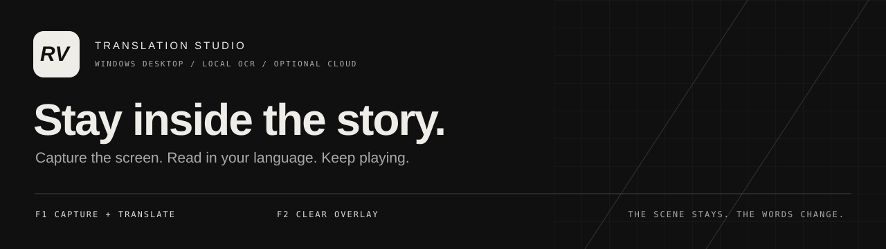
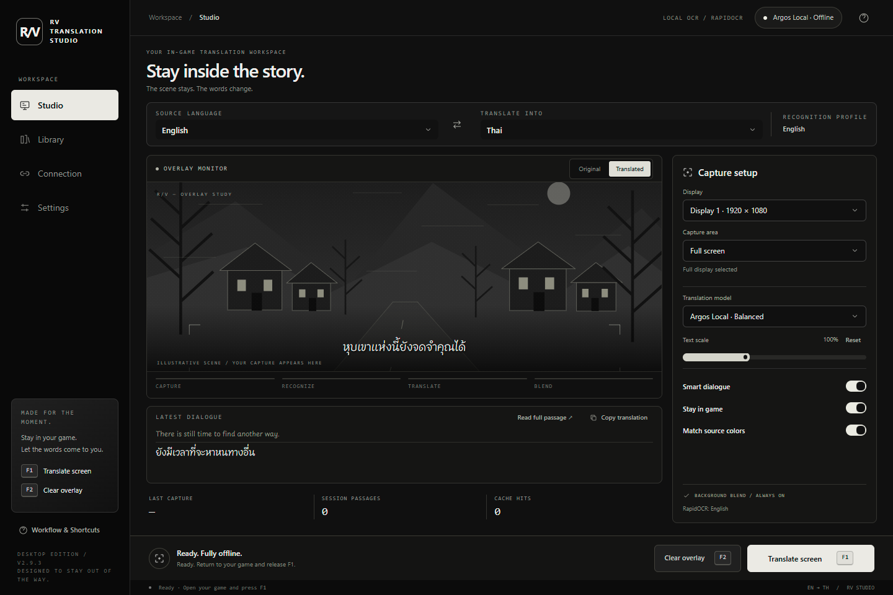
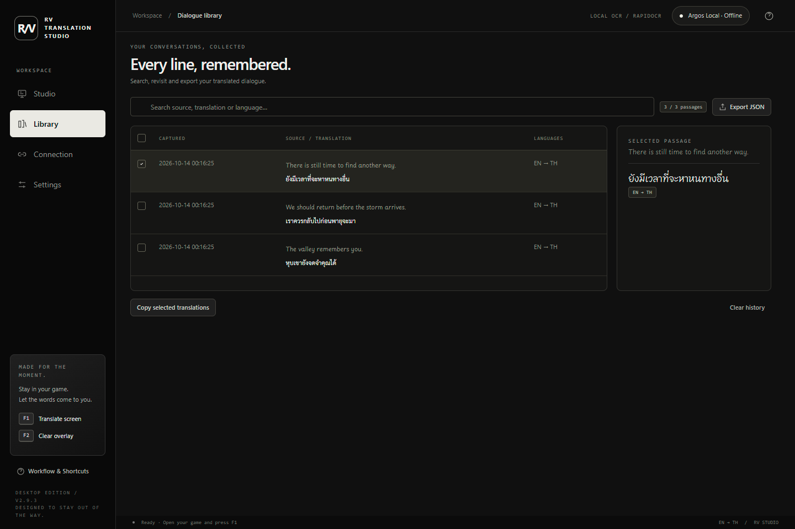
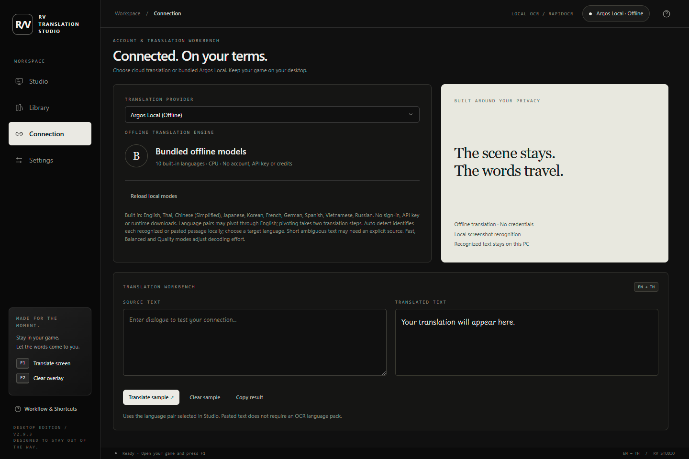
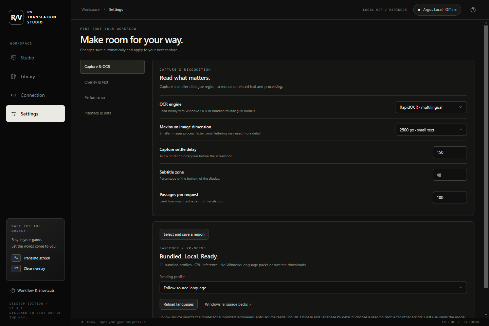

<p align="center"></p>

<p align="center"><strong>A Windows workspace for translating the screen without leaving the game.</strong><br>Local OCR · Offline or cloud translation · Blended overlays · One-key capture</p>

<p align="center">


</p>

<p align="center"><a href="#start-translating">Quick start</a> · <a href="#choose-your-engine">Engines</a> · <a href="docs/USER_GUIDE.md">User guide</a> · <a href="docs/BUILD.md">Build from source</a> · <a href="docs/BENCHMARKS.md">Benchmarks</a></p>



*Actual desktop UI with illustrative dialogue entered for documentation. The scene in the empty preview is an illustration; captured gameplay appears there after a translation.*

## The scene stays. The words change.

RV Translation Studio captures dialogue, reads it locally, translates it, and paints the result over the captured scene. Source text colors can carry across to the translation, while background blending fills the original glyph areas. Use **F1** from the game to translate and **F2** to clear the overlay.

Choose a fully local setup with RapidOCR and Argos, or connect a supported cloud provider when you want a different translation model. The monochrome workspace brings capture, comparison, history, connection, and advanced settings into one desktop app.

> **Project status:** this repository contains the **2.9.3 source preview**. The measured benchmark uses the **2.9.2 baseline**. No downloadable `.exe` release has been published here yet. Large model files are prepared separately when building from source.

## What you can do

| Feature | In practice |
| --- | --- |
| Translate from the game | Global F1 capture on key release; keep the workspace out of the way |
| Pick exactly what to read | Full display, subtitle zone, or F1 → drag a custom region → translate |
| Read locally | Windows native OCR, bundled RapidOCR, or PowerShell compatibility backend |
| Translate offline | Ten Argos languages, direct English routes, and English-pivot routes |
| Connect cloud models | ChatGPT account sign-in or Gemini API key; model access depends on the account |
| Keep dialogue together | OCR line grouping, offline sentence splitting, and local source detection |
| Blend into the scene | Source-color sampling, background inpainting, and adjustable text scale |
| Review and reuse | Original/translated preview, searchable Library, copy, and JSON export |
| Tune the workflow | Advanced capture, OCR, timeout, cache, blend, appearance, and motion controls |
| Find the bottleneck | Performance Lab timings for capture, OCR, preparation, translation, and blending |

## Start translating

1. Launch the prepared Windows application, or follow the [source setup](docs/BUILD.md).
2. In **Connection**, choose **Argos Local**, sign in to **ChatGPT**, or configure a **Gemini API key**.
3. In **Studio**, select source/target languages, display, capture area, and model. Choose a matching OCR reading profile in Settings.
4. Return to the game and release **F1**. In Custom area mode, drag around the text; releasing the mouse starts translation.
5. Read the overlay, then press **F2** before the scene changes.

| Key | Action |
| --- | --- |
| **F1** | Capture and translate; opens the crop selector in Custom area mode |
| **F2** | Clear the overlay |
| **Esc** | Cancel region selection |

Windowed or borderless games are the best starting point. Exclusive fullscreen, protected capture surfaces, or another application owning a shortcut may interfere. Translation is **capture-triggered**, not a continuous realtime video translator.

## Choose your engine

### Translation

| Provider | Connection | Best fit | Constraints |
| --- | --- | --- | --- |
| **Argos Local** | None; bundled models | Offline operation and low translation latency | Ten languages; long or complex sentences can lose clauses |
| **ChatGPT** | Browser sign-in using OAuth/PKCE | Model choice and contextual dialogue translation | Eligible account/model access, network, and account quotas |
| **Gemini** | API key in a masked native dialog | Google's available API models | API quota/billing is separate from Google AI Pro/Ultra |

The retained Gemini CLI option is intended for eligible organization Code Assist access. Personal-account CLI access has returned an unsupported-client response; use API key mode for personal Gemini usage. Signing in does not itself guarantee translation entitlement.

**Argos languages:** English, Thai, Chinese (Simplified), Japanese, Korean, French, German, Spanish, Vietnamese, and Russian. Eighteen model directions connect English to the other nine languages; non-English pairs use an English pivot, giving 90 directed pairs between distinct supported languages.

**Fast / Balanced / Quality** select different decoding effort. They are not accuracy guarantees. The cloud language picker contains a broad language/locale catalog; actual support depends on the provider and model.

### OCR

| Engine | Local? | Language setup |
| --- | --- | --- |
| **Windows native** | Yes | Installed Windows OCR languages |
| **RapidOCR / PP-OCRv5** | Yes | Eleven bundled reading profiles; no Windows language packs |
| **Windows via PowerShell** | Yes | Compatibility route using installed Windows OCR languages |

RapidOCR profiles cover English, Chinese/Japanese, Korean, Latin/Vietnamese, Thai, Cyrillic, Arabic, Devanagari, Greek, Tamil, and Telugu. They are script-specific recognition models, not universal recognition of every language simultaneously.

With RapidOCR and **Auto** source, **Follow source** defaults to Chinese/Japanese/English. Select a profile manually for another script. Auto language detection runs after recognition. See the [OCR guide](docs/USER_GUIDE.md#ocr-and-language-detection).

## A workspace built around the moment

<table><tr>
<td width="50%"><br><strong>Library</strong> — find, compare, copy, and export recent passages.</td>
<td width="50%"><br><strong>Connection</strong> — choose a provider and test text independently of OCR.</td>
</tr></table>

<details><summary><strong>Explore advanced settings</strong></summary>



Adjust capture size and delay, subtitle area, passage limits, OCR engine/profile, translation timeout, cache, background mask padding, inpainting radius, text scale, source colors, click-to-clear, and interface motion.

</details>

The dashboard uses **Tailwind CSS 4 + daisyUI 5** inside **Qt WebEngine**, connected to Python through **Qt WebChannel**. Compiled assets are packaged with the app; the UI does not require Node.js, a web server, or a CDN at runtime. Dialogue uses Playpen Sans Thai, with Thai-aware wrapping.

## Measured performance

Warm translation-stage medians on a Ryzen 9 7900, using RapidOCR, English → Thai, and disabled client translation cache:

| Input | Argos Balanced | OpenAI GPT-6 Luna |
| --- | ---: | ---: |
| Short sentence, 5 words | **0.022 s** | 3.440 s |
| Long single sentence, 63 words | **0.188 s** | 6.011 s |
| Paragraph, 115 source words | **0.253 s** | 6.577 s |
| Full-screen fixture, 10 text rows | **0.141 s** | 6.936 s |

These numbers cover translation only. The benchmark collected 176 pipeline samples and 24 live cloud calls on 13 October 2026. **All Argos modes omitted later clauses in the long single-sentence fixture; the cloud result retained them.** Low latency does not imply equivalent completeness.

Read the [methodology, OCR timings, pipeline totals, and limitations](docs/BENCHMARKS.md) before comparing engines. In-app Performance Lab is the best way to measure your own screen and hardware.

## Build it yourself

The [Windows build guide](docs/BUILD.md) covers dependencies, pinned model downloads, UI compilation, validation, and packaging. After preparing dependencies and assets:

```powershell
python main.py
python -m unittest discover -s tests -q
.\build.ps1 -AppName RVTranslationStudio-2.9.3
```

The all-model single-file build is approximately 2.6 GB and takes time to extract on a cold launch. Executables, downloaded models, dependency installations, and generated UI assets are kept out of Git.

## Privacy and practical limits

- Capture, OCR, detection, color sampling, and blending run locally. Argos also translates locally.
- Cloud providers receive recognized text and translation instructions, not the screenshot image. Full-screen OCR can include unrelated private text.
- Credentials use Windows DPAPI. History, settings, and translation cache are local JSON files and are not encrypted.
- The overlay is made from a captured frame. Clear it when the scene moves; complex textures and animated backgrounds can show blending artifacts.
- OCR depends on the profile, font, contrast, and resolution. Translation can omit or misinterpret content, especially with local models and mixed-language text.

See [privacy](docs/PRIVACY.md) and [troubleshooting](docs/USER_GUIDE.md#troubleshooting).

## Documentation and credits

- [User guide and shortcuts](docs/USER_GUIDE.md)
- [Run and build on Windows](docs/BUILD.md)
- [Benchmark results](docs/BENCHMARKS.md)
- [Privacy and local storage](docs/PRIVACY.md)
- [Source release notes](CHANGELOG.md)
- [Third-party notices](THIRD_PARTY_NOTICES.md)

Built with PyQt6/Qt WebEngine, daisyUI, RapidOCR, ONNX Runtime, Windows OCR, Argos Translate, CTranslate2, Lingua, pySBD, and PyThaiNLP. Fonts: Playpen Sans Thai and Sarabun. This is an independent application, not an official OpenAI, Google, or game-publisher product.

No project-wide open-source license has been selected. Third-party components retain their own licenses and attribution requirements; their inclusion does not assign a license to the application source.
