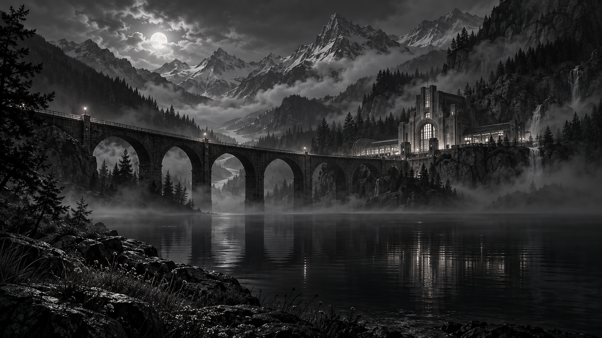

# Default studio artwork

This generated illustration is the Studio's initial preview. It is replaced by the user's actual capture after a translation. It is not a screenshot of a game and contains no user screen data.

## Generation brief

Built-in imagegen was used for a cinematic monochrome alpine valley at night: a stone viaduct above a still lake, an art-deco railway station, layered mountain fog and moonlight. The lower center stays dark enough for overlaid dialogue. No text, logos, people, or watermark were requested.
