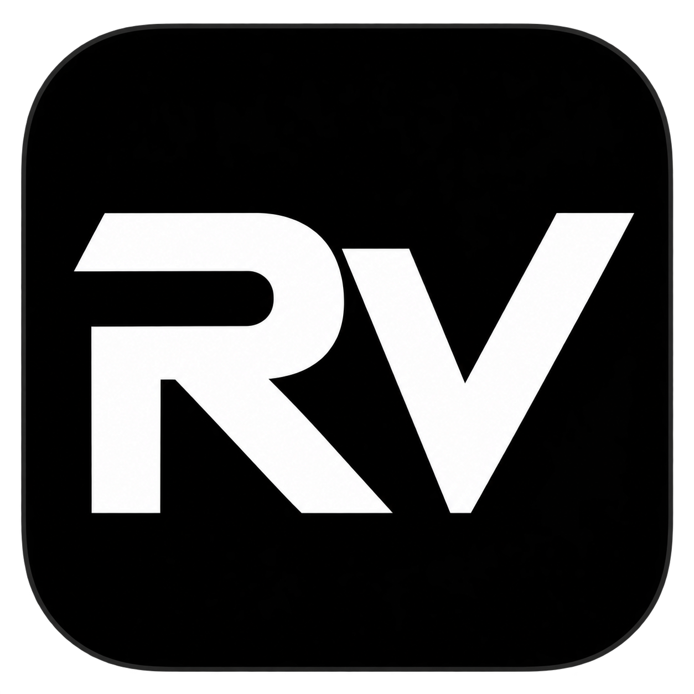

# RV brand assets

The RV monogram is supplied in two generated PNG variants, both with a rounded-square tile and transparent outer corners:

| White on black | Black on white |
| --- | --- |
|  |  |

The white-on-black variant is used in the application sidebar and the Windows icon. `assets/app.ico` contains 16, 24, 32, 48, 64, 128, and 256 pixel frames derived from this logo for Windows display sizes. Original PNG exports are preserved without creative post-processing.

These are project brand assets; this notice does not grant a trademark or project-wide source license.
