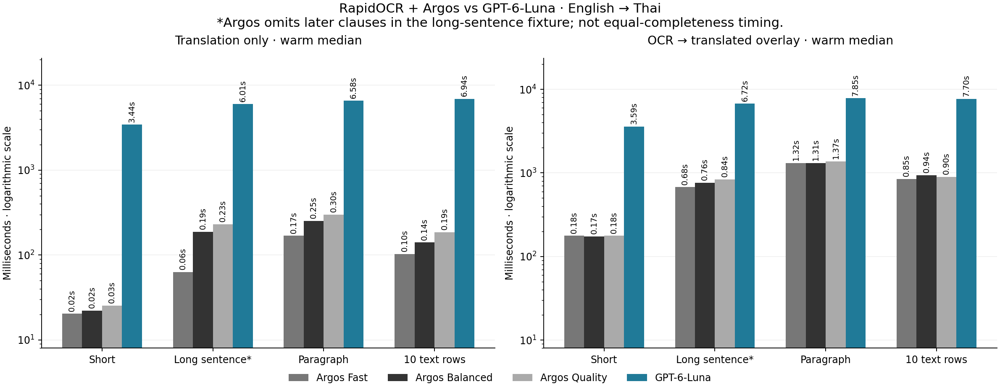

# RapidOCR + translation benchmark

Measured on **13 October 2026**, using the **2.9.2 baseline**, an AMD Ryzen 9 7900 (12 cores / 24 threads), and approximately 63 GiB usable RAM. These are observations from this machine and these fixtures, not a latency guarantee.

The run collected **176 pipeline samples**: 96 inference measurements and 80 separate client-cache-hit measurements. These included **24 live OpenAI translation calls** using the account's GPT-6 Luna model. Source language was Auto, the fixtures were English, and the target was Thai. The client translation cache was disabled during inference measurements. Each case/provider included a first run and five warm inference runs, followed by five cached runs. RapidOCR used the Chinese/Japanese/English profile, the default for Auto source.

## Warm translation median

Seconds spent in the translation stage only:

| Fixture | Argos Fast | Argos Balanced | Argos Quality | OpenAI GPT-6 Luna |
| --- | ---: | ---: | ---: | ---: |
| Short, 5 words | 0.020 | 0.022 | 0.025 | 3.440 |
| Long single sentence, 63 words | 0.063 | 0.188 | 0.231 | 6.011 |
| Paragraph, 115 source words | 0.168 | 0.253 | 0.300 | 6.577 |
| Full-screen fixture, 10 text rows | 0.103 | 0.141 | 0.186 | 6.936 |

**Speed is only part of the result. Every Argos mode omitted later clauses in the 63-word single sentence.** The cloud output retained those clauses. Argos Quality also omitted a food item in one paragraph where other local modes kept it. The mode names describe decoding effort; they do not establish an accuracy ranking.

## Warm fixture pipeline median

Seconds for PNG serialization, OCR, preparation, translation, blending, and rendering. These values **exclude native screen capture, configured capture delay, UI scheduling, application startup, and model extraction from the executable**.

| Fixture | Argos Fast | Argos Balanced | Argos Quality | OpenAI GPT-6 Luna |
| --- | ---: | ---: | ---: | ---: |
| Short | 0.177 | 0.174 | 0.177 | 3.585 |
| Long single sentence | 0.678 | 0.762 | 0.838 | 6.717 |
| Paragraph | 1.317 | 1.313 | 1.373 | 7.847 |
| 10 text rows | 0.847 | 0.940 | 0.898 | 7.703 |

## OCR observations

| Fixture | Auto default profile, ms | English profile, ms |
| --- | ---: | ---: |
| Short | 90.9 | 89.1 |
| Long single sentence | 362.5 | 347.9 |
| Paragraph | 574.7 | 538.7 |
| 10 text rows | 331.3 | 289.7 |

Normalized English word error rate was 0% on these clean fixtures except the paragraph with the Auto default profile (1.74%). This metric ignores case and punctuation and does not represent recognition accuracy in textured, animated games. A separate native desktop capture measurement had a warm median of 12.74 ms; no desktop screenshot was retained or sent to a provider during that measurement.

## Reproduction and interpretation

`tools/benchmark_rapid_translation.py` creates public dialogue fixtures and runs the actual OCR, translation, and blend pipeline. It requires the locally built 2.9.2 `PYZ-00.pyz` archive used for this historical comparison, prepared model assets, and dependencies. That archive and raw artifacts are excluded from Git. Inspect `--help` before running; live cloud calls require the explicit `--live-openai` flag and a locally connected eligible account.

`tools/report_rapid_benchmark.py` generates summaries and charts from benchmark output. Network conditions, model availability, text length, installed hardware, cold startup, and model cache state can change results substantially. No broad translation-quality score was calculated.
